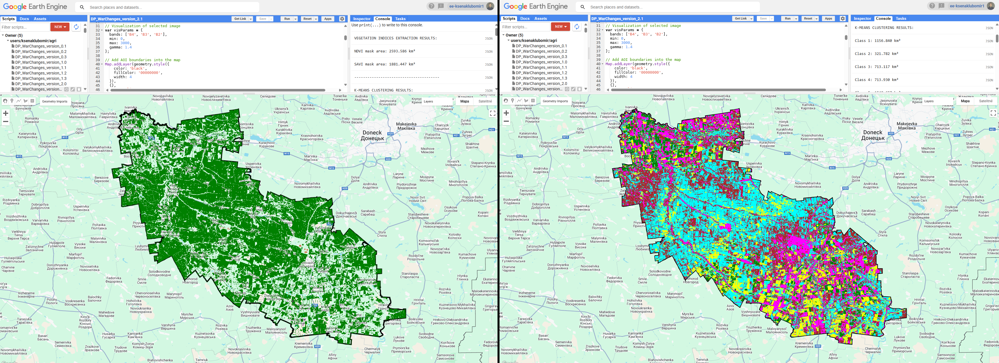

# G I D A L 
**G**eospatial **I**dentification of the Extent of War **D**amage on **A**gricultural **L**and in the Google Earth Engine Cloud Environment

## Overview
This code enables the geospatial identification of war-related damage on agricultural land using Google Earth Engine. It processes Sentinel-2 imagery to calculate vegetation indices (NDVI, SAVI), applies masks for agricultural areas, and performs both unsupervised (K-Means) and supervised (Random Forest) classification. The script computes the area of vegetation and different land cover classes, providing quantitative outputs for each category. Finally, it visualizes and prepares the results for export.

## Authors
- Ľubomír Kseňak and Jakub Kuraj - Technical university of Košice, Slovakia - 2025

## Version
**v2.1** 
- Loading ESA WorldCover and masking agriculture land
- Applying ESA WorldCover reference area for calculation vegetation indices and classification

**v2.0** 
- Application of Random Forest classification algorithm 
- Print results do RF classifier into the console 
- Adding AOI boundaries into the map 
- Optimalization of results visualization 
- Validation on RF classification results

**v1.3** 
- Calculate and print area of NDVI and SAVI masks (3 decimal places) 
- Improve clustering results in console (3 decimal places + km2 labels after value)

**v1.2** 
- Correct labeling of classes during clustering 
- Voluntary export image to Google drive 

**v1.1** 
- K-Means clusters area results printed separately in console (in km square) 

**v1.0** 
- AOI specification by shapefile 
- K-Means clustering calculation 
- Data visualization 

**v0.2** 
- Setting transparent background for false values in masks 
- Adding selected image to map view 

**v0.1** 
- Creation of script 
- Data Selection 
- Calculation NDVI and SAVI 
- Data visualization 

## Requirements
- A **Google Earth Engine** account.
- Internet access and a compatible web browser.

## License
- This project is released under the **MIT License**. Feel free to modify and use it for your applications.
